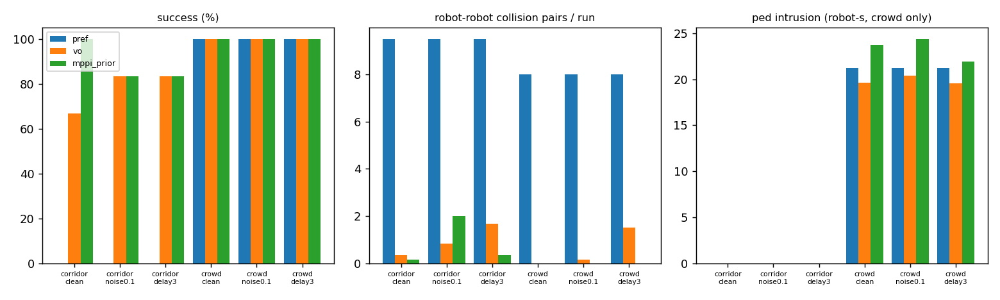

# Robustness: noise, delay, corridor, crowd

n=8 robots, 6 seeds (seed granularity = 17 pp, so differences of one seed are noise), max_t=60 s.
Conditions: clean / 0.1 m (and 0.1 m/s) Gaussian on neighbour pos+vel / neighbours stale by 3 ticks (0.3 s).
Reproduce: `python3 src/rosnav_bot/scripts/decentral_nav_sim.py robust --n 8 --seeds 6`.
Ped metrics (crowd only): contact = robot-ped centre distance < 0.55 m; intrusion = robot-seconds inside 1.2 m of a ped.

| scenario | ctrl | condition | success % | makespan s | robot coll pairs | ped contacts | ped intrusion s | min ped dist m |
|---|---|---|---|---|---|---|---|---|
| corridor | pref | clean | 0 | nan | 9.50 | 0.00 | 0.0 | nan |
| corridor | pref | noise0.1 | 0 | nan | 9.50 | 0.00 | 0.0 | nan |
| corridor | pref | delay3 | 0 | nan | 9.50 | 0.00 | 0.0 | nan |
| corridor | vo | clean | 67 | 28.5 | 0.33 | 0.00 | 0.0 | nan |
| corridor | vo | noise0.1 | 83 | 33.3 | 0.83 | 0.00 | 0.0 | nan |
| corridor | vo | delay3 | 83 | 31.3 | 1.67 | 0.00 | 0.0 | nan |
| corridor | mppi_prior | clean | 100 | 40.1 | 0.17 | 0.00 | 0.0 | nan |
| corridor | mppi_prior | noise0.1 | 83 | 40.9 | 2.00 | 0.00 | 0.0 | nan |
| corridor | mppi_prior | delay3 | 83 | 34.8 | 0.33 | 0.00 | 0.0 | nan |
| crowd | pref | clean | 100 | 23.2 | 8.00 | 8.00 | 21.2 | 0.07 |
| crowd | pref | noise0.1 | 100 | 23.2 | 8.00 | 8.00 | 21.2 | 0.07 |
| crowd | pref | delay3 | 100 | 23.2 | 8.00 | 8.00 | 21.2 | 0.07 |
| crowd | vo | clean | 100 | 25.3 | 0.00 | 0.00 | 19.7 | 0.58 |
| crowd | vo | noise0.1 | 100 | 26.1 | 0.17 | 0.17 | 20.4 | 0.51 |
| crowd | vo | delay3 | 100 | 26.4 | 1.50 | 1.33 | 19.5 | 0.47 |
| crowd | mppi_prior | clean | 100 | 33.6 | 0.00 | 0.67 | 23.8 | 0.22 |
| crowd | mppi_prior | noise0.1 | 100 | 34.1 | 0.00 | 1.17 | 24.4 | 0.03 |
| crowd | mppi_prior | delay3 | 100 | 34.1 | 0.00 | 2.67 | 21.9 | 0.21 |

## Honest read

- **pref** ignores neighbours, so noise/delay change nothing (identical rows). It never clears the corridor (0 %, ~9.5 collision pairs/run: head-on jam) and walks through pedestrians (8 contacts/run, min distance 0.07 m). It is the floor, not a contender.
- **vo** is the best in the crowd and fastest in the corridor, but is brittle in the corridor: 67 % clean (deadlock or timeout in 2 of 6 seeds). Noise/delay did not lower success here (83 %), which is one seed of difference, not an improvement. What delay does hurt is safety: collision pairs rise 0.33 -> 1.67 (corridor) and 0 -> 1.5 (crowd, ped contacts 0 -> 1.33). Delayed velocity estimates make its constant-velocity time-to-collision stale exactly when pedestrians turn or neighbours reverse.
- **mppi_prior** is the only controller at 100 % in the corridor clean, with ~0.2 collision pairs, but it is the one that breaks under 0.1 m observation noise: 83 % success and collision pairs 0.17 -> 2.0 in the corridor (the 1.5 m width leaves ~0.3 m of slack between two passing robots, so 0.1 m noise is a third of the margin). Delay hurt it less in the corridor (0.33 pairs). In the crowd it never collides with robots, but it is slowest (34 s vs 25 s) and the worst around pedestrians: 0.67 contacts clean -> 2.67 under delay, min distance down to 0.03 m under noise. Its rollouts predict constant neighbour velocity, and its sampling cost has only a soft margin (2R+0.7), so a ped that sways into a rollout it already committed to gets hit.
- Personal-space intrusion (~20-24 robot-s) is similar for vo and mppi_prior and not sensitive to noise/delay: crossing a hall with 8 walkers inside 60 s makes 1.2 m violations near-unavoidable for all three.
- Caveats: 6 seeds, one n, one corridor length. Pedestrians are weak reactors and straight-line walkers (the optimistic case for constant-velocity prediction). Own state is exact, and the delay applies to neighbours/peds only. Treat orderings as indicative; the clear findings are pref's failure, vo's drop in safety under delay, and mppi_prior's corridor collisions under noise.
